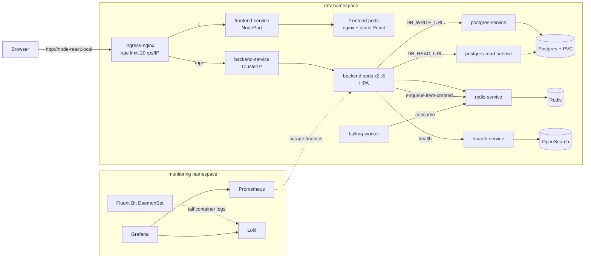

# Node + React + Postgres — Production-Style Local Platform

DevOps Engineer hands-on assessment (Cloudly). A small full-stack app
(React/Vite + Node.js/Express + PostgreSQL) taken through six stages:

| # | Task | Where |
|---|------|-------|
| 1 | Containerized local setup (multi-stage images, Compose) | `Dockerfile.*`, `.dockerignore`, `docker-compose.yml` |
| 2 | Kubernetes (kind) in the `dev` namespace | `k8s/` |
| 3 | Ingress as API gateway at `http://node-react.local` | `k8s/ingress-dev.yaml` |
| 4 | CI/CD with branch → namespace mapping | `.github/workflows/ci-cd.yml` |
| 5 | Redis, BullMQ queue, OpenSearch, read/write DB split | `k8s/redis-*`, `k8s/bullmq-*`, `k8s/search-*`, `backend/src/db.js` |
| 6 | Prometheus, Grafana, Fluent Bit → Loki, HPA, rate limiting | `observability/`, `k8s/hpa-backend.yaml` |

Evidence (screenshots) is in [`docs/`](docs/).

---

## Architecture



```
.
├── Dockerfile.backend          # multi-stage: deps -> slim runtime, non-root
├── Dockerfile.frontend         # multi-stage: vite build -> nginx static + /api proxy
├── .dockerignore
├── .env.example                # copy to .env (git-ignored) for Compose
├── docker-compose.yml
├── backend/                    # Express API, BullMQ worker, /metrics, tests
├── frontend/                   # React (Vite) + nginx.conf template
├── k8s/                        # all app manifests for the dev namespace
│   └── cluster/kind-config.yaml
├── observability/              # Prometheus, Grafana, Loki, Fluent Bit
├── scripts/kind-up.sh          # one-command kind bring-up
├── .github/workflows/ci-cd.yml
└── docs/                       # screenshots / evidence
```

---

## 1. Prerequisites & one-command startup

| Tool | Version used |
|------|--------------|
| Docker Desktop / Engine + Compose v2 | 29.x |
| kind | v0.29.0 (Kubernetes v1.33) |
| kubectl | 1.33 |
| bash (Git Bash on Windows) | for `scripts/kind-up.sh` |

### Docker Compose (Task 1 + Task 5)

```bash
cp .env.example .env        # set your own local password
docker compose up --build
```

| URL | What |
|-----|------|
| http://localhost:8080 | React app (nginx proxies `/api/*` to the backend) |
| http://localhost:4000/api/health | Backend directly |
| http://localhost:4000/metrics | Prometheus metrics |
| `127.0.0.1:5432` | Postgres (bound to localhost only, for debugging) |

Redis, the worker and OpenSearch have **no published ports**: they are only
reachable on the internal `backend-net` network.

Check it works end to end:

```bash
curl -XPOST localhost:8080/api/items -H 'Content-Type: application/json' -d '{"name":"hello"}'
curl localhost:8080/api/items
curl localhost:8080/api/health/redis     # {"status":"ok"}
curl localhost:8080/api/health/search    # {"status":"ok","cluster":"green"}
docker compose logs worker               # "processing item-created ..."
docker compose restart postgres && curl localhost:8080/api/items   # data survives
```

### Kubernetes on kind (Tasks 2, 3, 5, 6)

```bash
./scripts/kind-up.sh                         # app + platform services
WITH_OBSERVABILITY=1 ./scripts/kind-up.sh    # + Prometheus/Grafana/Loki/Fluent Bit
```

The script is idempotent. It:
1. creates the `node-react` kind cluster (`k8s/cluster/kind-config.yaml`, host ports 80/443/30080 mapped),
2. installs **ingress-nginx** and **metrics-server** (for the HPA),
3. builds both images and `kind load`s them (no registry needed locally),
4. `kubectl apply -f k8s/` and waits for the rollouts.

Then add the hostname (once):

```
# Linux/macOS: /etc/hosts     Windows: C:\Windows\System32\drivers\etc\hosts (as admin)
127.0.0.1 node-react.local
```

| URL | What |
|-----|------|
| http://node-react.local | App through the Ingress |
| http://node-react.local/api/items | Backend through the Ingress |
| http://localhost:30080 | Frontend NodePort (Task 2, without Ingress) |
| `kubectl -n monitoring port-forward svc/grafana 3000:3000` → http://localhost:3000 | Grafana (anonymous viewer; admin/`dev-only-change-me`) |
| `kubectl -n monitoring port-forward svc/prometheus 9090:9090` | Prometheus |

Tear down: `docker compose down` (add `-v` to wipe the DB volume) / `kind delete cluster --name node-react`.

---

## Task 1: Docker / Compose design

* **Multi-stage builds.**
  * Backend: the `deps` stage runs `npm ci --omit=dev`, and the runtime stage copies only
    `node_modules` + `src/` onto `node:20-alpine`. It runs as the non-root `node` user and has a
    `HEALTHCHECK`. The same image runs the API and the BullMQ worker (`command` override).
  * Frontend: the `build` stage runs `vite build`, and the runtime is `nginx:1.27-alpine` with only
    `dist/`: no Node, no source, no `node_modules` (~74 MB vs ~216 MB backend).
* **Layer caching.** `package*.json` is copied and installed before the source, so code changes don't reinstall deps.
  `.dockerignore` keeps `node_modules`, `.git`, `.env`, docs and manifests out of the context.
* **Networking.** Services find each other by Compose service name via Docker's embedded DNS
  (`postgres`, `redis`, `search`, `backend`). There are two networks:
  `frontend-net` (frontend ↔ backend) and `backend-net` (backend ↔ data stores).
  The frontend container **cannot** reach Postgres.
* **Same-origin API.** The React bundle calls `VITE_API_BASE_URL` (default `/api`, a build arg).
  nginx proxies `/api/` to `BACKEND_UPSTREAM` (env var, rendered by the nginx image's `envsubst`
  templates). This avoids CORS and works the same behind the Ingress.
* **No hardcoded secrets.** Credentials come from `.env` (git-ignored) with `${VAR:?}` guards, so
  Compose fails fast if a value is missing. Only `.env.example` is committed.
* **Persistence.** The named volume `postgres_data` survives `restart`, `stop` and `down` (only `down -v` deletes it).
* **Startup ordering.** `depends_on: condition: service_healthy` uses real healthchecks
  (`pg_isready`, `redis-cli ping`, `/api/health/live`), not just "container started".

## Task 2: Kubernetes design

| Resource | Type | Exposure |
|----------|------|----------|
| `frontend-service` | NodePort 30080 | **external** |
| `backend-service` | ClusterIP :4000 | internal |
| `postgres-service`, `postgres-read-service` | ClusterIP :5432 | internal |
| `redis-service`, `search-service` | ClusterIP | internal |

* Everything lives in the `dev` namespace (`namespace-dev.yaml`).
* **Config vs secrets.** `app-configmap.yaml` holds non-sensitive values (hosts, ports, URLs).
  `app-secrets.yaml` holds DB credentials, which are consumed with `secretKeyRef`. The DB
  connection URLs are assembled at runtime with `$(VAR)` expansion, so the password never
  lands in a ConfigMap. `app-secrets.yaml` is **dev-only**: CI never applies it (see Task 4).
* **Storage.** `postgres-pv.yaml` (hostPath, `Retain`) is bound to `postgres-pvc.yaml`. Postgres uses the
  `Recreate` strategy so two pods never mount the same RWO data directory. On a cloud cluster the
  PV file goes away and a StorageClass provisions it dynamically. A StatefulSet would be the next
  step for real replication.
* **Probes.** The backend has two kinds:
  * **readiness** `/api/health/ready` checks the DB connection. A failing pod is taken out of the Service endpoints but is *not* restarted.
  * **liveness** `/api/health/live` checks the process only, so a DB outage doesn't trigger a restart storm.
  * Postgres uses `pg_isready`, Redis uses `redis-cli ping`, and the frontend uses `/healthz`.
* **Safe rollouts.** `maxUnavailable: 0`, `maxSurge: 1` and `revisionHistoryLimit: 10` (for rollback). Resource
  requests/limits are set everywhere (the HPA needs requests). Containers run non-root with a read-only root filesystem
  and `allowPrivilegeEscalation: false`.

## Task 3: Ingress, request path, DNS, debugging

`k8s/ingress-dev.yaml` (ingressClass `nginx`, host `node-react.local`):
`/api` (Prefix) → `backend-service:4000`, and `/` → `frontend-service:80`. The longest matching prefix wins.

### Request path: Browser → Ingress → Service → Pod → PostgreSQL

1. **Browser → node.** `node-react.local` resolves to `127.0.0.1` via the hosts file. kind maps host
   port 80 to the node container, where the ingress-nginx controller pod listens (hostPort).
2. **Ingress controller.** nginx (configured from the Ingress object) matches the host and path,
   applies the rate limit, and picks the backend **Service**.
3. **Service → Pod.** ingress-nginx reads the Service's **Endpoints/EndpointSlices** and proxies
   straight to a *Ready* pod IP. For pod-to-Service traffic (backend → Postgres), kube-proxy's
   iptables/IPVS rules DNAT the ClusterIP to one of the endpoints.
4. **Pod → PostgreSQL.** The backend connects to `postgres-service:5432` (writes) or
   `postgres-read-service:5432` (reads). The ClusterIP then routes to the Postgres pod, and the
   data lands on the PVC.

Responses travel the same way back. `/` follows the same path but ends at an nginx frontend pod that
serves static files.

### How Kubernetes DNS resolves services

* CoreDNS gives every Service an A record: `<service>.<namespace>.svc.cluster.local`,
  e.g. `backend-service.dev.svc.cluster.local` → the Service's ClusterIP.
* Each pod's `/etc/resolv.conf` has `search dev.svc.cluster.local svc.cluster.local cluster.local`
  and `ndots:5`, so inside `dev` the short name `postgres-service` works. From another namespace
  you need at least `postgres-service.dev`.
* The ClusterIP is stable for the life of the Service, while pod IPs change on every reschedule. That
  is why clients always target the Service name. (Headless Services return pod IPs directly; that's
  what a StatefulSet DB cluster would use.)
* Check it with: `kubectl run -n dev dns --rm -it --image=busybox:1.36 -- nslookup backend-service`.

### Debugging

**(a) Ingress is reachable (frontend loads) but `/api` returns 502/503/504:**
1. `kubectl get ingress -n dev` / `kubectl describe ingress node-react-ingress -n dev`: check the right host, path and service name/port. Backends showing `<error: endpoints not found>` is the giveaway.
2. `kubectl get endpoints backend-service -n dev`. **Empty** means the selector doesn't match the pod labels, *or* no pod is Ready.
3. `kubectl get pods -n dev -l app=backend` and `kubectl describe pod ...`: look for readiness probe failures, CrashLoopBackOff or ImagePullBackOff.
4. `kubectl logs -n dev deploy/backend`. A common cause is that the DB is unreachable, so readiness fails, so there are no endpoints. Check `postgres-service` the same way.
5. Bypass the Ingress: `kubectl port-forward -n dev svc/backend-service 4000:4000` → `curl localhost:4000/api/health/ready`. If that works, the problem is the Ingress/controller: `kubectl logs -n ingress-nginx deploy/ingress-nginx-controller`.
6. A 503 with many requests can be the **rate limit** (see Task 6).

**(b) Frontend can't talk to the backend:**
1. Browser DevTools → Network: where is the request going? It must be `/api/...` on the *same
   origin*. If it goes to `http://backend-service:4000` or `localhost:4000`, the bundle was built with a
   wrong `VITE_API_BASE_URL`. That name only resolves *inside* the cluster, never in the browser.
   Rebuild the image with the correct build arg.
2. CORS/mixed-content errors mean the base URL isn't same-origin (fix as above).
3. 404 on `/api/...` means the Ingress path rule is missing, or (NodePort path) nginx `BACKEND_UPSTREAM` is wrong:
   `kubectl exec -n dev deploy/frontend -- cat /etc/nginx/conf.d/default.conf`.
4. Test in-cluster connectivity from the frontend pod:
   `kubectl exec -n dev deploy/frontend -- wget -qO- http://backend-service:4000/api/health`.
   If DNS fails, check CoreDNS (`kubectl get pods -n kube-system -l k8s-app=kube-dns`). If it times out, check NetworkPolicies.

### Evolving into microservices

The Ingress is already a path-based API gateway. Splitting the backend means adding
`users-service`, `orders-service` and so on, each with its own Deployment + ClusterIP Service + DB schema, and a rule
per prefix (`/api/users` → `users-service`, ...). Service-to-service calls use DNS names, and
async work goes through the existing queue (events instead of tight coupling). As this grows I would add:
* a real gateway (Kong / Envoy Gateway / Gateway API `HTTPRoute`) for auth (JWT), per-route/per-consumer
  rate limits, request IDs and API versioning
* a service mesh (Linkerd/Istio) for mTLS, retries/timeouts and per-service golden metrics
* one Helm chart/Kustomize base per service, so each one deploys and rolls back independently

## Task 4: CI/CD & multi-environment

`.github/workflows/ci-cd.yml`

| Branch | Namespace | GitHub Environment |
|--------|-----------|--------------------|
| `master` | `dev` | `dev` |
| `pre-release/v*` | `preprod` | `preprod` |
| `release/v*` | `release` | `release` (add required reviewers) |

Jobs:
1. **build-and-test** (push + PR):
   * `npm ci` for both apps
   * `node --check` on every backend module, then backend unit tests (`node --test`)
   * `vite build`
   * `docker compose config` validation
   * **kubeconform** schema validation of `k8s/` and `observability/`
2. **build-and-push** (push only):
   * builds both images with Buildx and GHA layer cache
   * tags them **`<branch>-<shortsha>`** (immutable, e.g. `master-1a2b3c4`, `release-v1.2-9f8e7d6`) plus a moving `<env>-latest`
   * pushes to **GHCR**, with image names lower-cased (GHCR requirement)
3. **deploy**:
   * renders the manifests for the target namespace (image tag, namespace, per-env PV name, `<env>.node-react.local` host)
   * creates the namespace and Secrets **from CI secrets**
   * runs `kubectl apply`, `rollout status` and an in-cluster smoke test (POST + GET through the frontend proxy)
   * on failure against a real cluster, automatically runs `kubectl rollout undo`
4. **rollback** (manual `workflow_dispatch`): see below.

**No cluster configured?** A real local kind cluster isn't reachable from GitHub-hosted runners.
When the `KUBECONFIG_B64` secret is absent, the deploy job spins up an **ephemeral kind cluster
inside the runner** (`helm/kind-action`) and deploys the freshly pushed GHCR images there. So every
run genuinely proves "these exact images + manifests deploy and serve traffic". With the secret set,
the same steps target the real cluster.

### How CI secrets are stored and used

| Secret | Where | Used for |
|--------|-------|----------|
| `GITHUB_TOKEN` | auto-generated per run, expires when the job ends | push to GHCR (`packages: write`), and an `imagePullSecret` so the cluster can pull private images |
| `KUBECONFIG_B64` | **Environment** secret (`dev` / `preprod` / `release`) | base64 kubeconfig for a ServiceAccount whose RoleBinding covers **only that namespace** |
| `DB_PASSWORD` | Environment secret | creates the `app-secrets` Secret in the namespace (`kubectl create secret --dry-run=client -o yaml \| kubectl apply -f -`) |

Principles:
* no credentials in the repo. `k8s/app-secrets.yaml` is dev-only and excluded by CI.
* least privilege: the workflow-level `permissions` block only grants `contents: read`, `packages: write`.
* environment-scoped secrets, so a `master` push can never read `release` credentials.
* required reviewers on `release`.
* GitHub masks secrets in logs.

Next steps: OIDC federation to a cloud cluster instead of a static kubeconfig, and
Sealed Secrets/External Secrets Operator (Vault/AWS SM) for runtime secrets.

### Rollback strategy

1. **Automatic.** The deploy job waits on `kubectl rollout status`. With `maxUnavailable: 0`, a broken
   version never receives traffic, because its pods never become Ready and the old ReplicaSet keeps
   serving. If the rollout fails, the job runs `kubectl rollout undo`.
2. **Fast manual.** Run the workflow with `rollback_namespace=<env>`. That runs
   `kubectl rollout undo deployment/backend|frontend`, which goes back to the previous ReplicaSet (history: 10 revisions,
   each annotated with `change-cause` = commit + tag). Locally: `kubectl rollout history -n dev deploy/backend`, then
   `kubectl rollout undo -n dev deploy/backend --to-revision=N`.
3. **Precise.** Run the workflow with `rollback_to_tag=master-1a2b3c4`. That runs `kubectl set image` to that
   immutable, already-tested image. Every build is kept in GHCR, so any past version can be redeployed
   without rebuilding.
4. DB schema changes must be backward compatible (expand → migrate → contract) so app rollback never
   needs a DB rollback.

## Task 5: Platform services

| Service | Compose | Kubernetes | Backend wiring |
|---------|---------|-----------|----------------|
| Redis 7 | `redis` (no ports) | `redis-deployment.yaml`, `redis-service.yaml` | `REDIS_URL`, `GET /api/health/redis` |
| BullMQ queue (on Redis) | `worker` | `bullmq-worker-deployment.yaml` | `POST /api/items` enqueues `item-created`, and the worker consumes it |
| OpenSearch 2.15 (single-node) | `search` (no ports) | `search-deployment.yaml`, `search-service.yaml` | `SEARCH_URL`, `GET /api/health/search` |
| Read/write DB | `postgres` + network alias `postgres-replica` | `postgres-service` (writer) + `postgres-read-service` (reader) | `DB_WRITE_URL`, `DB_READ_URL` |

* **Why BullMQ.** It reuses Redis, so there's one less stateful system to run. The worker is the same image with
  a different entrypoint and its own Deployment, so it scales independently and API latency
  isn't affected by slow jobs. A natural job is indexing new items into OpenSearch.
* **Isolation.**
  * All platform services are ClusterIP only, with no published Compose ports.
  * `k8s/network-policy.yaml` allows ingress to Postgres/Redis/search only from backend and worker pods. It is enforced by
    Calico/Cilium; kind's default CNI ignores it.
  * OpenSearch runs with the security plugin off **only** because it is unreachable from outside.

### Read/write routing: where the logic lives

Here it is explicit **in application code** (`backend/src/db.js`): two `pg.Pool`s.
`write()` → `DB_WRITE_URL` (primary) for INSERT/UPDATE/DELETE/DDL, and `read()` → `DB_READ_URL`
(replica) for SELECTs (`GET /api/items`). Today both URLs point at the same instance through two
Service names. Moving to a real replica is a config change only: point `postgres-read-service`'s
selector at the replica (or use a CloudNativePG/Patroni `-ro` service).

Alternatives:
* **A DB proxy** (Pgpool-II, ProxySQL-style routers, AWS RDS Proxy / Aurora reader endpoint) makes routing
  transparent to the app. The trade-offs: an extra hop, and the proxy can't know about the app's
  consistency needs.
* **An ORM/driver feature** (e.g. Prisma read replicas, Sequelize replication).

I prefer app-level routing because only the app knows which reads tolerate staleness.

### Replication lag

Async replicas apply the primary's WAL milliseconds (sometimes seconds, under load or vacuum) later.
So a replica read can return **stale** data. Operations that must always hit the **writer**:
* all writes and DDL/migrations
* **read-your-own-writes**: re-fetching a record right after creating/updating it (e.g. redirect after
  POST). Here `POST /api/items` returns the row from `INSERT ... RETURNING` on the writer, instead of re-reading from the replica
* reads inside a transaction that also writes; `SELECT ... FOR UPDATE`; uniqueness/balance/stock checks
  before a write; auth/session/permission changes; idempotency checks for the queue
* anything whose correctness depends on the latest value (payments, counters)

Mitigations:
* pin a user to the primary for N seconds after they write (sticky-after-write)
* compare WAL positions (`pg_last_wal_replay_lsn()`) to decide whether a replica is fresh enough
* monitor replica lag (`pg_stat_replication`) and remove lagging replicas from the read pool

## Task 6: Observability, scaling, rate limiting

### Metrics: Prometheus + Grafana

* The backend exposes `/metrics` (`prom-client`):
  * process CPU, RSS memory, event-loop lag and GC (`backend_*`)
  * `http_requests_total{method,route,status}`
  * `http_request_duration_seconds` histogram (route *template* labels keep cardinality bounded)
* `/metrics` is not routed by the Ingress (only `/api` is), so it isn't public.
* Prometheus discovers pods through the Kubernetes API and scrapes those annotated
  `prometheus.io/scrape: "true"` in `dev`/`preprod`/`release`. Alert rules are in `observability/prometheus.yaml`.
* Grafana is provisioned from code (datasources + **Backend Overview** dashboard) with these panels:
  * backend **CPU** per pod
  * backend **memory** per pod
  * **request rate** by route/status
  * **error rate** (5xx and 4xx ratio)
  * **number of backend replicas over time** (`count(up{app="backend"}==1)`)
  * p50/p95 latency
  * a Loki logs panel

### What I'd alert on, and why

| Alert | Rule (simplified) | Why |
|-------|-------------------|-----|
| **High error rate** (page) | 5xx / total > 5% for 5m | The most direct symptom of user pain; independent of traffic volume |
| **No healthy backends** (page) | `absent(up{app="backend"}==1)` for 2m | Total outage / scrape failure |
| **High latency** (warn) | p95 > 500 ms for 10m | Catches degradation (slow queries, DB lock, saturated event loop) that error rate misses |
| **High CPU** (warn) | avg CPU > 80% of limit for 10m | Saturation; on its own it's a cause, not a symptom, so it's a warning |
| **HPA at max** (warn) | `kube_horizontalpodautoscaler_status_current_replicas == max` (needs kube-state-metrics) | No headroom left; the next spike becomes latency/errors |
| Others with more time | Postgres connections/replication lag, Redis memory, BullMQ queue depth & failed jobs, PVC usage, ingress 429 rate | Leading indicators of the above |

I alert on **symptoms** (errors, latency, availability) as pages, and on **causes** (CPU, queue depth) as
warnings, with `for:` windows so short spikes don't wake anyone up.

### Logging: Fluent Bit → Loki

* **Fluent Bit** runs as a **DaemonSet**: one collector per node, tailing
  `/var/log/containers/*_{dev,preprod,release}_*.log`.
  * It parses the CRI format and enriches records with Kubernetes metadata.
  * It ships to **Loki** with labels `namespace`, `app`, `container`.
* The backend writes one **structured JSON line per request** (`level`, `method`, `route`, `status`,
  `duration_ms`). Health probes are skipped to cut noise.
* Queries in Grafana → Explore → Loki:
  ```logql
  {app="backend"}                                   # all backend logs
  {app="backend"} |= "item-created"                 # text filter
  {app="backend"} | json | status >= 400             # parsed-field filter
  {app="backend"} | json | duration_ms > 100         # slow requests
  sum by (status) (count_over_time({app="backend"} | json [5m]))
  ```

### Autoscaling

`k8s/hpa-backend.yaml` scales the backend from **2 to 6** replicas.
* Targets: CPU 70% of the 100m request, or memory 80%.
* min 2 keeps HA through a node/pod failure.
* Scale-up is immediate (+2 pods/30 s). Scale-down waits 5 min (−1 pod/min) to avoid flapping.
* metrics-server is installed by `kind-up.sh`.

Load test:
```bash
kubectl run -n dev load --rm -it --image=busybox:1.36 -- sh -c \
  'while true; do wget -qO- http://backend-service:4000/api/items >/dev/null; done'
kubectl get hpa -n dev -w
```

### Rate limiting

This is done at the **Ingress** (edge), via ingress-nginx annotations on `ingress-dev.yaml`:
* `limit-rps: 20` per client IP
* `limit-burst-multiplier: 5` (burst of 100)
* `limit-connections: 20`
* `proxy-body-size: 1m`

`kind-up.sh` sets `limit-req-status-code: 429` on the controller so clients get a proper *429 Too Many Requests*.

Why these numbers:
* A page load is ~3–5 requests, and a human clicking around stays well below 5 rps. **20 rps sustained / 100 burst**
  never affects real users, but it stops a single scripting client or a retry loop from monopolising 2 backend pods.
* Each pod is sized at 100m CPU, and the list endpoint is a DB read.
* Limiting at the edge rejects abusive traffic **before** it consumes pod CPU, DB connections or
  autoscaling budget. Rate limiting in the app would need shared state (Redis) across replicas.

Trade-off: the limit is per-IP and per-controller-replica, so users behind corporate NAT share a limit.
With more time I would key on an API key/user (gateway plugin, or Redis-backed sliding window) and
set separate limits for write endpoints (`POST`) vs reads.

Verify:
```bash
for i in $(seq 1 300); do curl -s -o /dev/null -w "%{http_code}\n" http://node-react.local/api/items; done | sort | uniq -c
```

---

## 7. Design decisions, trade-offs, and what I'd do with more time

**Decisions**

* **kind over minikube.** It runs in Docker, needs no VM, starts fast, gets `extraPortMappings` for
  80/443 and `kind load` for images without a registry, and the same tool runs in CI.
* **Plain YAML over Helm/Kustomize.** The assessment asks for readable manifests, so I used one file per resource.
  CI renders per-environment differences with `sed`. *Trade-off:* that's brittle at scale; see below.
* **Postgres as a Deployment + static PV.** It's the simplest thing that fits the PV/PVC requirement.
  *Trade-off:* no replication/failover. Production would use a managed DB or an operator (CloudNativePG).
* **Same-origin `/api` everywhere** (nginx proxy in Compose, Ingress in k8s): one image works in every
  environment without rebuilding for a different API URL, and no CORS.
* **One backend image, two roles** (API/worker): one build and one vulnerability surface to patch.
* **Hand-rolled observability manifests** instead of kube-prometheus-stack: small, readable and enough for the
  required dashboards. *Trade-off:* no kube-state-metrics/cAdvisor dashboards out of the box.
* **Ephemeral kind in CI** when no cluster secret exists, so the pipeline is green *and* meaningful.

**With more time**

1. **Kustomize** base + overlays (`dev`/`preprod`/`release`), or a Helm chart, replacing the `sed` templating.
   Then **Argo CD** (GitOps): CI only bumps the image tag in Git, Argo syncs, and rollback = `git revert`.
2. **Terraform** (optional in the brief): `tehcyx/kind` provider for the cluster, `helm` provider for
   ingress-nginx/kube-prometheus-stack/Loki, and a real cluster module (EKS/GKE) for preprod/release.
3. **Postgres HA:** CloudNativePG with real streaming replicas and `-rw`/`-ro` services (drop-in for
   `DB_WRITE_URL`/`DB_READ_URL`), PgBouncer, automated backups + PITR, and versioned migrations
   (node-pg-migrate) instead of `CREATE TABLE IF NOT EXISTS` at startup.
4. **Security:**
   * Sealed Secrets / External Secrets
   * Trivy image scan + SBOM + cosign signing in CI
   * Pod Security Admission `restricted`
   * Calico/Cilium so the NetworkPolicy is actually enforced, plus default-deny
   * TLS via cert-manager
5. **Observability:** kube-prometheus-stack (Alertmanager → Slack/PagerDuty, kube-state-metrics for replica/HPA
   panels), ingress-nginx metrics (edge request/429 rates), OpenTelemetry tracing (API → queue → worker),
   SLOs with burn-rate alerts.
6. **Delivery:** canary/blue-green with Argo Rollouts gated on Prometheus error rate; HPA on
   request rate / queue depth via KEDA (scale the worker on BullMQ backlog); PodDisruptionBudgets.
7. More tests: API integration tests against a Postgres service container in CI, e2e (Playwright).

---

## Evidence (`docs/`)

| Screenshot | What it shows |
|-----------|---------------|
| `docs/kubectl-get-all-dev.png` | `kubectl get all -n dev` |
| `docs/app-node-react-local.png` | App running at http://node-react.local |
| `docs/grafana-dashboard.png` | Backend Overview dashboard |
| `docs/loki-logs.png` | Loki log query in Grafana Explore |
| `docs/github-actions.png` | Passing GitHub Actions run |
| `docs/compose-up.png` | `docker compose ps` / Compose stack healthy |
